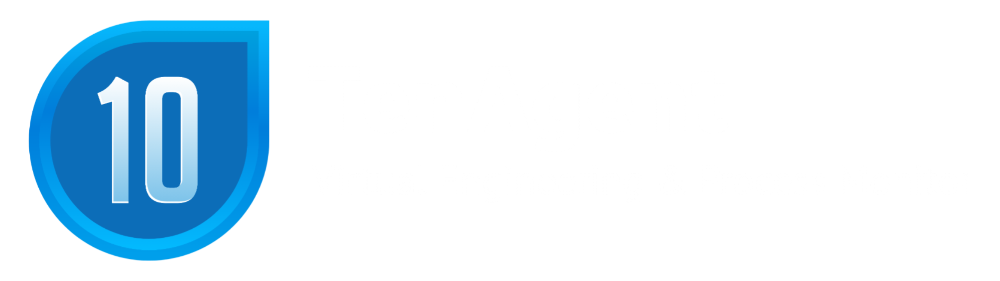
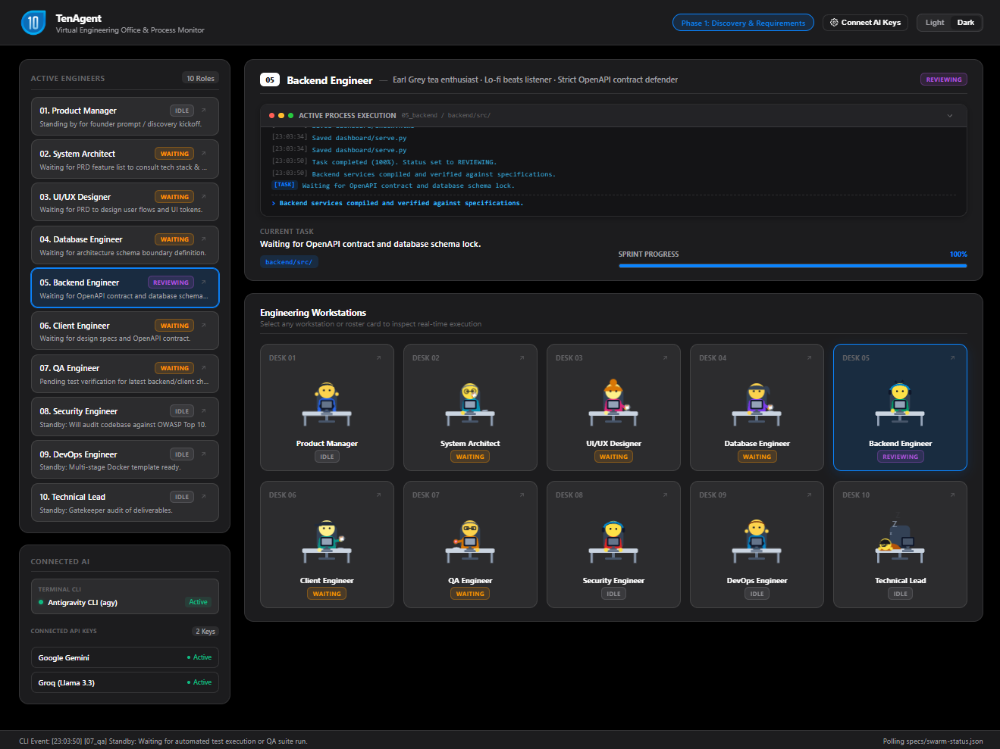
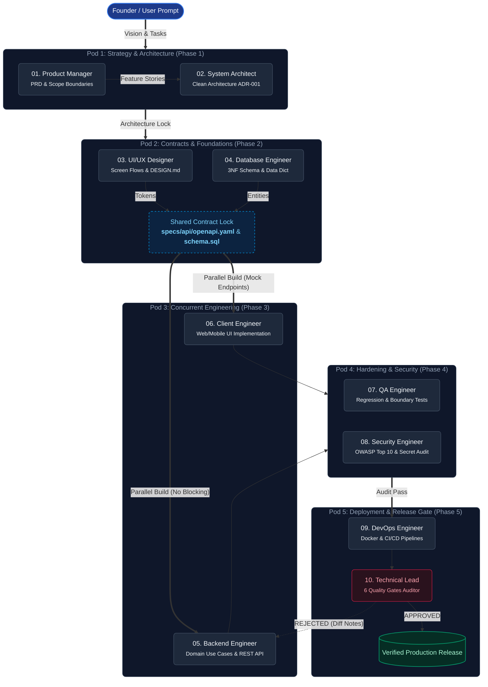

<p align="center">
  
</p>

<p align="center">
  <b>10-Agent Engineering Swarm Workspace & 2D Virtual Office</b><br>
  <i>An autonomous, contract-first multi-agent framework to take any software idea from concept to production with zero architectural drift.</i>
</p>

<p align="center">
  <a href="#core-architecture"></a>
  <a href="#2d-virtual-office-monitor-dashboard"></a>
  
  <a href="#anti-slop-discipline"></a>
  <a href="LICENSE"></a>
</p>

<p align="center">
  
</p>

---

## Local dashboard operator access

The Virtual Office runs on loopback and requires operator login for its pages,
logs, configuration, and command API. Start it with `python dashboard/serve.py`
or the documented launcher. Open the local URL printed in the terminal and
authenticate with username `tenagent` and the random password printed there.

For a stable operator password, set `TENAGENT_DASHBOARD_PASSWORD` in the shell
before starting TenAgent. Keep the password private; never commit it or expose
the dashboard to untrusted hosts. The server intentionally does **not** enable
cross-origin browser access. The command API's existing CSRF token is an
additional check, **not** a replacement for operator authorization.

If the dashboard was previously accessible on a shared network, rotate any
provider keys saved while that version was in use.

---

## The Problem TenAgent Solves

When a single AI coding agent is asked to architect schemas, write frontend components, build backend endpoints, create unit tests, and configure Docker containers in a single conversation context, its **context window degrades rapidly**.

As a project grows past a few files, three common failure modes occur:
1. **Architectural Drift**: The AI forgets constraints established in earlier prompts, reinventing duplicate database tables or altering column names across endpoints.
2. **Contract Mismatch**: Frontend API calls hallucinate parameters that the backend never implemented.
3. **Generic Boilerplate ("AI Slop")**: Code gets cluttered with obvious comments (e.g. `// fetch user`, `// render screen`) and generic, uninspired styling.

**TenAgent** solves this by structuring your project into **10 specialized virtual engineering roles**. Each agent focuses exclusively on its narrow domain of responsibility, communicating strictly through version-controlled specifications (`specs/`) and formal API contracts.

---

## Core Architecture & Office Pods

TenAgent organizes the engineering lifecycle into **5 Collaborative Office Pods**, mirroring a high-performing engineering organization:



---

## The 10 Engineering Roles

| # | Role | Domain Mandate | Primary Deliverables | Standard Enforced |
|:---:|:---|:---|:---|:---|
| **01** | **Product Manager** | Discovery interviews, scoping, user stories, acceptance criteria | `specs/prd/*.md` | Anti-slop copywriting |
| **02** | **System Architect** | Tech stack selection, Clean Architecture layer boundaries | `specs/architecture/*.md` | Strict domain isolation |
| **03** | **UI/UX Designer** | User flows, wireframes, accessible color tokens | `specs/design/*.md`, `DESIGN.md` | WCAG AA contrast, >=44px tap targets |
| **04** | **Database Engineer** | 3NF schema normalization, ERDs, centralized Data Dictionary | `specs/database/schema.sql` | Zero redundant tables or keys |
| **05** | **Backend Engineer** | Domain use cases, entities, repository adapters | `backend/src/...` | Adheres strictly to OpenAPI spec |
| **06** | **Client Engineer** | Web or Mobile user interfaces built in parallel | `frontend/` or `mobile/` | Mocks endpoints against OpenAPI spec |
| **07** | **QA Engineer** | Edge-case hunter, automated unit & integration tests | `tests/`, `specs/qa/*.md` | Boundary & regression validation |
| **08** | **Security Engineer** | OWASP Top 10 auditing, auth/authz verification | `specs/security/*.md` | Zero token or secret leakage |
| **09** | **DevOps Engineer** | Multi-stage Docker builds, reproducible CI/CD pipelines | `Dockerfile`, `.github/` | Zero-drift deployment builds |
| **10** | **Technical Lead** | Gatekeeper audit against 6 Quality Gates before merge | `specs/reviews/*.md` | Rejects substandard or drifting code |

---

## Key Capabilities

### 1. Virtual Office Monitor (`dashboard/`)
TenAgent includes a zero-dependency, ultra-lightweight web dashboard running on port `7777`:
* **Zero Lag**: Built entirely with pure semantic HTML5, CSS3, and responsive SVGs (under 60KB total). No bulky canvas or heavy WebGL dependencies.
* **Live Process Inspection**: Click on any desk or roster card to open the **Engineer Dossier Modal** with persona traits, domain mandates, and deliverables.
* **Micro-Step Synchronizer**: Accurately reflects CLI activity, file changes, and sub-second log streams without fake work animations.
* **Strict Port Isolation**: Dashboard runs on dedicated port `7777` (with auto-range up to `7827`), ensuring zero collision with project development servers (ports `3000`, `5173`, `4000`, `8000`).

### 2. Autonomous Multi-AI Council & Debate (`council.py`)
Connect external API keys (Google Gemini, Groq, DeepSeek, Anthropic Claude, OpenAI, or local Ollama) in the dashboard modal:
* **Dynamic Model Pool**: Automatically detects whichever keys are active in `specs/swarm-config.json`.
* **Adversarial Pre-Flight Debate**: Before major architectural decisions or schema creation, the fastest model (e.g. Groq) acts as the **Red Team / Challenger** to stress-test the proposal, while a secondary model (e.g. Gemini 2.5 Flash) defends and refines the solution.
* **Live Streamed Debates**: Transcripts stream directly to `specs/terminal.log` and appear live in the Virtual Office monitor.
* **Graceful Fallback**: If no external keys are configured, TenAgent functions seamlessly under your native CLI engine (e.g. Antigravity) with zero disruption.

### 3. Anti-Slop Discipline
TenAgent integrates the `.agents/skills/antislop*` hygiene guidelines:
* **Minimalist Comments**: Never write obvious comments (e.g. `// fetch user`, `// render screen`). Code must be self-documenting. Comments are strictly reserved for non-obvious business logic or algorithmic edge cases.
* **Concise Commits**: Single-line Conventional Commits (`feat(auth): add google oauth provider`, `fix(db): add unique constraint on users.email`).
* **Human-Centered UI**: Tactile custom inputs, purposeful contrast, and zero generic cookie-cutter templates.

---

## Quick Start Guide

### Prerequisites
* **Environment**: Windows 10 / 11 (PowerShell or Command Prompt)
* **Python**: Python 3.9+ (no external `pip` packages required for core dashboard or council)
* **AI Assistant CLI**: Any CLI assistant ([Google Antigravity](https://github.com/google-deepmind), Kiro CLI, Claude Code, Gemini CLI, or any LLM runner)

### Step 1: Clone Repository
```bash
git clone https://github.com/yoepan/tenagent.git
cd tenagent
```

### Step 2: Launch Virtual Office Dashboard
On Windows, simply double-click:
```cmd
office.bat
```
Or run via terminal:
```bash
python dashboard/serve.py
```
Open your browser at **http://localhost:7777/dashboard/**.

### Step 3: Start Building with Your AI Assistant
Open a separate terminal window in the project folder and launch your AI assistant (e.g. `agy`):
```bash
agy
```
Give your master prompt:
> *"I want to build an automated store POS system with offline inventory and receipt printing. Start Phase 1 discovery."*

Watch your 10 virtual engineers collaborate, debate edge cases, lock contracts, and implement your application live in the Virtual Office Monitor!

---

## Directory Structure

```text
├── .agents/
│   ├── roles/             # Detailed playbooks for all 10 engineering roles
│   └── skills/            # Integrated anti-slop filters (code, UI, copywriting)
├── assets/                # Screenshots and repository banner assets
│   ├── logo.png           # High-resolution project logo
│   └── dashboard-preview.png # Screenshot of the 2D Virtual Office
├── dashboard/             # 2D Animated Virtual Office Simulator
│   ├── index.html         # Responsive SVG office interface & Dossier modal
│   ├── serve.py           # Port-isolated HTTP server & CLI presence detector
│   ├── favicon.png        # Brand icon
│   └── favicon.ico        # Multi-resolution favicon (16x16, 32x32, 48x48)
├── specs/                 # Version-controlled contract directory
│   ├── swarm-status.json  # Real-time state machine for all 10 engineers
│   ├── swarm-config.example.json # Safe configuration template (git-tracked)
│   ├── prd/               # User stories & acceptance criteria
│   ├── architecture/      # Architecture Decision Records (ADRs)
│   ├── design/            # Screen flows, wireframes, and DESIGN.md
│   ├── database/          # 3NF schemas and Data Dictionary
│   ├── api/               # Shared OpenAPI 3.1 contracts
│   ├── qa/                # Test matrices and bug reproduction logs
│   ├── security/          # Threat models and OWASP audit reports
│   └── reviews/           # Technical Lead gatekeeper sign-offs
├── AGENTS.md              # Master operating rules and swarm execution lifecycle
├── council.py             # Dynamic Multi-AI Council & debate runner
├── stream.py              # Sub-second terminal logger and stream runner
├── stream.bat             # 1-click terminal streaming wrapper
├── office.bat             # 1-click Windows Virtual Office launcher
├── .gitignore             # Shields local API keys and execution logs
└── README.md              # Repository documentation
```

---

## Security & Privacy

TenAgent is built with a **security-first configuration architecture**:
* Your active API keys are stored locally in `specs/swarm-config.json` which is **strictly ignored by git** via `.gitignore`.
* Public clones receive `specs/swarm-config.example.json` with empty credentials.
* On the first run, the server automatically initializes your local config without exposing any secret keys to GitHub.

---

## License

This project is licensed under the [MIT License](LICENSE). You are free to use, modify, and distribute it for both commercial and open-source software projects.
